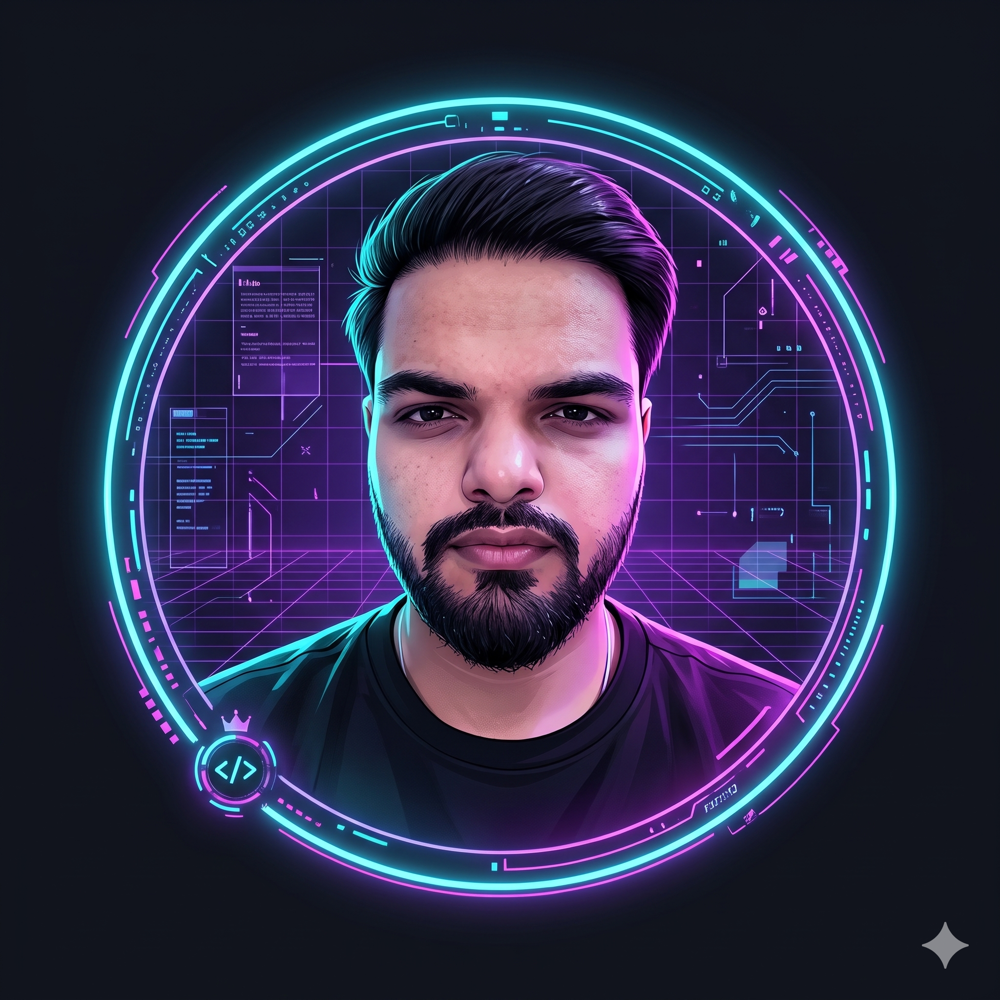

<!-- ==================== ROYAL HOLOGRAPHIC HERO BANNER ==================== -->

  

 

<!-- ==================== HERO PROFILE & BIO CARD ==================== -->
<table align="center">
  <tr>
    <td align="center" width="230">
      
        
      
      
      
    </td>
    <td width="590" valign="middle">
      
        
      
      

        An <b>ECE undergrad</b> passionate about architecting scalable full-stack web applications, exploring <b>offensive cybersecurity</b>, and solving <b>real-world problems</b> with clean, resilient code.
      

      
      
      
      
    </td>
  </tr>
</table>

 

<!-- ==================== ABOUT HIGHLIGHTS ==================== -->

  

 

<table align="center">
  <tr>
    <td width="410" valign="middle">
      <blockquote>
        <i>"Dream in <b>Code</b>. Think Like a <b>Hacker</b>. Build Like an <b>Engineer</b>."</i>
      </blockquote>
      Currently diving deep into web application security, vulnerability research, and scalable MERN architectures.
    </td>
    <td width="410" valign="middle">
       <b>Full Stack MERN Developer</b>  
       <b>Cybersecurity & Bug Bounty Explorer</b>  
       <b>Building Real-World Full-Stack Apps</b>  
       <b>DSA & Problem Solving (C++)</b>
    </td>
  </tr>
</table>

 

<!-- ==================== TECH STACK ==================== -->

  

 

<table align="center">
  <tr>
    <th align="center" width="275"><code>&lt;/&gt;</code> Languages</th>
    <th align="center" width="275"><code>🎨</code> Frontend</th>
    <th align="center" width="275"><code>⚙️</code> Backend</th>
  </tr>
  <tr>
    <td align="center">
       
      <b>C++</b> • <b>Python</b> • <b>JavaScript</b>
    </td>
    <td align="center">
       
      <b>HTML5</b> • <b>CSS3</b> • <b>React.js</b> • <b>Vite</b>
    </td>
    <td align="center">
       
      <b>Node.js</b> • <b>Express.js</b>
    </td>
  </tr>
  <tr>
    <th align="center"><code>🗄️</code> Database</th>
    <th align="center"><code>🛠️</code> Tools & Platforms</th>
    <th align="center"><code>🔐</code> Security & Pentesting</th>
  </tr>
  <tr>
    <td align="center">
       
      <b>MongoDB</b> • <b>MySQL</b>
    </td>
    <td align="center">
       
      <b>Git</b> • <b>GitHub</b> • <b>VS Code</b> • <b>Postman</b>
    </td>
    <td align="center">
       
      <b>Burp Suite</b> • <b>Nmap</b> • <b>Kali Linux</b> • <b>OWASP</b>
    </td>
  </tr>
</table>

 

<!-- ==================== FEATURED PROJECTS ==================== -->

  

 

<table align="center">
  <tr>
    <td width="410" valign="top">
      <h3>🛒 Artstore &nbsp;<code>MERN E-Commerce</code></h3>
      
Full-stack e-commerce platform for an art store with a complete shopping and order experience.

      <ul>
        <li>✔️ Product & Cart Management</li>
        <li>✔️ Razorpay Payment Integration</li>
        <li>✔️ Order Processing & Tracking</li>
        <li>✔️ Transactional Email (Resend)</li>
        <li>✔️ Admin Dashboard</li>
      </ul>
      

        
        
        
        
        
      

      
      
    </td>
    <td width="410" valign="top">
      <h3>🤖 AI Resume Builder &nbsp;<code>AI Powered</code></h3>
      
AI-powered resume builder that generates professional resumes using Google Gemini.

      <ul>
        <li>✔️ Gemini API Integration</li>
        <li>✔️ Resume Builder & Live Preview</li>
        <li>✔️ PDF Generation (jsPDF)</li>
        <li>✔️ User Authentication (JWT)</li>
        <li>✔️ Modern & Interactive UI</li>
      </ul>
      

        
        
        
        
        
      

      
    </td>
  </tr>
</table>

 

<!-- ==================== GITHUB ANALYTICS & CURRENTLY LEARNING ==================== -->

  

 

<table align="center">
  <tr>
    <td align="center" width="520">
      
       
      
      
    </td>
    <td width="300" valign="middle">
      <h4>📖 Currently Learning</h4>
      <ul>
        <li>🛡️ <b>Web Application Security</b></li>
        <li>🐞 <b>Bug Bounty Hunting</b></li>
        <li>🔍 <b>Penetration Testing</b></li>
        <li>💻 <b>Advanced DSA (C++)</b></li>
        <li>🧠 <b>AI App Development</b></li>
      </ul>
    </td>
  </tr>
</table>

 

<!-- ==================== CONTRIBUTION SNAKE ==================== -->

  

 

<!-- ==================== LET'S CONNECT FOOTER ==================== -->

  
    
  
  
  
  
    
  ✦ Crafted with code & curiosity by <b>Raghav Sharma</b> ✦

